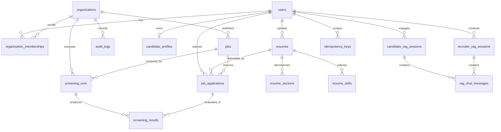

# TalentLens: Database Schema & Multi-Tenant Security Architecture

**Document Version**: 4.0  
**Database Engine**: PostgreSQL 16  
**Application Database Role**: `talentlens_app` (Least-privilege, `NOBYPASSRLS`, non-superuser)  
**Schema Owner / Migration Role**: `talentlens_admin` (Dedicated schema owner)  

---

## Version 4 Corrections

The following authoritative architectural corrections have been implemented in Version 4:
1. **Complete RLS on `organizations`**: Added `ENABLE/FORCE ROW LEVEL SECURITY` and explicit operation-level policies (`SELECT`, `INSERT`, `UPDATE`, `DELETE`) to the `organizations` table.
2. **Hardened Security-Definer Functions**: Specified explicit schema owner (`talentlens_admin`), locked down safe `search_path = pg_catalog, public`, schema-qualified all queries, and restricted privileges for the non-superuser `talentlens_app` role.
3. **Rigorous Dual-Context Validation**: Enforced that `fn_has_active_org_membership(org_id, required_role)` strictly verifies `app.current_user_id`, asserts that `app.current_org_id` exactly matches `org_id`, validates active membership status, and enforces role hierarchy (`OWNER >= ADMIN >= RECRUITER >= VIEWER`).
4. **Referential Integrity for Screening Results**: Introduced composite unique constraints and composite foreign keys linking `screening_results(job_application_id, job_id, candidate_id, evaluated_resume_id)` directly to `job_applications(id, job_id, candidate_id, submitted_resume_id)` and `(screening_run_id, organization_id, job_id)` to `screening_runs`.
5. **Complete Resume Immutability**: Implemented comprehensive trigger `trg_protect_submitted_resumes` using NULL-safe `IS DISTINCT FROM` to freeze all resume content, hashes, version identifiers, sections, and skills once submitted to any application.
6. **Screening Snapshot Immutability & Race Prevention**: Implemented trigger `trg_protect_screening_snapshots` blocking `INSERT`, `UPDATE`, or `DELETE` on `screening_results` if the parent run is `COMPLETED`. Screening finalization acquires an exclusive row lock (`SELECT FOR UPDATE`).
7. **Application Identity Protection & Status State Machine**: Implemented trigger `trg_protect_application_identity` locking `candidate_id`, `job_id`, `submitted_resume_id`, and `applied_at` against mutation, and enforcing valid application status transitions.
8. **Published-Only Application Trigger**: Implemented trigger `trg_validate_job_application_submission` asserting that candidates can only submit applications to jobs with `status = 'PUBLISHED'`.
9. **Tamper-Proof Audit Logging**: Created security-definer function `fn_record_audit_event(...)` that derives actor and tenant identity strictly from session context, and revoked direct `INSERT/UPDATE/DELETE` on `audit_logs` from `talentlens_app`.
10. **Chat Sender Role Spoofing Defense**: Added trigger and check constraints on `rag_chat_messages` enforcing that client-inserted messages must have `sender_role = 'USER'`.
11. **Idempotency Storage**: Added `idempotency_keys` table supporting distributed deduplication of application submissions and screening triggers.

---

## 1. Multi-Tenant Identity & Access Isolation Model



---

## 2. PostgreSQL DDL Specification

```sql
-- ============================================================================
-- EXTENSIONS & CUSTOM DOMAINS
-- ============================================================================
CREATE EXTENSION IF NOT EXISTS "uuid-ossp";
CREATE EXTENSION IF NOT EXISTS "pgcrypto";

CREATE TYPE public.system_role AS ENUM (
    'PLATFORM_USER',
    'PLATFORM_ADMIN'
);

CREATE TYPE public.organization_role AS ENUM (
    'OWNER',
    'ADMIN',
    'RECRUITER',
    'VIEWER'
);

CREATE TYPE public.membership_status AS ENUM (
    'INVITED',
    'ACTIVE',
    'SUSPENDED',
    'REVOKED'
);

CREATE TYPE public.application_status AS ENUM (
    'SUBMITTED',
    'UNDER_REVIEW',
    'SHORTLISTED',
    'INTERVIEWING',
    'REJECTED',
    'HIRED'
);

CREATE TYPE public.processing_status AS ENUM (
    'PENDING',
    'PROCESSING',
    'COMPLETED',
    'FAILED'
);

CREATE TYPE public.job_status AS ENUM (
    'DRAFT',
    'PUBLISHED',
    'CLOSED',
    'ARCHIVED'
);

CREATE TYPE public.sender_role AS ENUM (
    'USER',
    'ASSISTANT',
    'SYSTEM'
);

-- ============================================================================
-- 1. TENANTS & USER IDENTITY (DECOUPLED)
-- ============================================================================
CREATE TABLE public.organizations (
    id UUID PRIMARY KEY DEFAULT gen_random_uuid(),
    slug VARCHAR(64) UNIQUE NOT NULL,
    name VARCHAR(255) NOT NULL,
    domain VARCHAR(255),
    is_active BOOLEAN NOT NULL DEFAULT TRUE,
    created_at TIMESTAMPTZ NOT NULL DEFAULT CURRENT_TIMESTAMP,
    updated_at TIMESTAMPTZ NOT NULL DEFAULT CURRENT_TIMESTAMP
);

CREATE TABLE public.users (
    id UUID PRIMARY KEY DEFAULT gen_random_uuid(),
    email VARCHAR(255) UNIQUE NOT NULL,
    password_hash VARCHAR(255) NOT NULL,
    system_role public.system_role NOT NULL DEFAULT 'PLATFORM_USER',
    first_name VARCHAR(128) NOT NULL,
    last_name VARCHAR(128) NOT NULL,
    is_active BOOLEAN NOT NULL DEFAULT TRUE,
    is_verified BOOLEAN NOT NULL DEFAULT FALSE,
    created_at TIMESTAMPTZ NOT NULL DEFAULT CURRENT_TIMESTAMP,
    updated_at TIMESTAMPTZ NOT NULL DEFAULT CURRENT_TIMESTAMP
);

CREATE INDEX idx_users_email ON public.users(email);

CREATE TABLE public.organization_memberships (
    id UUID PRIMARY KEY DEFAULT gen_random_uuid(),
    organization_id UUID NOT NULL REFERENCES public.organizations(id) ON DELETE CASCADE,
    user_id UUID NOT NULL REFERENCES public.users(id) ON DELETE CASCADE,
    role public.organization_role NOT NULL DEFAULT 'RECRUITER',
    status public.membership_status NOT NULL DEFAULT 'ACTIVE',
    is_active BOOLEAN NOT NULL DEFAULT TRUE,
    invited_by_user_id UUID REFERENCES public.users(id) ON DELETE SET NULL,
    created_at TIMESTAMPTZ NOT NULL DEFAULT CURRENT_TIMESTAMP,
    updated_at TIMESTAMPTZ NOT NULL DEFAULT CURRENT_TIMESTAMP,
    CONSTRAINT uq_org_user_membership UNIQUE(organization_id, user_id)
);

CREATE INDEX idx_memberships_user ON public.organization_memberships(user_id, is_active);
CREATE INDEX idx_memberships_org ON public.organization_memberships(organization_id, is_active, role);

-- ============================================================================
-- 2. CANDIDATES & IMMUTABLE RESUME VERSIONS
-- ============================================================================
CREATE TABLE public.candidate_profiles (
    id UUID PRIMARY KEY DEFAULT gen_random_uuid(),
    user_id UUID UNIQUE NOT NULL REFERENCES public.users(id) ON DELETE CASCADE,
    headline VARCHAR(255),
    summary TEXT,
    phone VARCHAR(32),
    location VARCHAR(128),
    linkedin_url VARCHAR(255),
    github_url VARCHAR(255),
    portfolio_url VARCHAR(255),
    total_years_experience NUMERIC(4, 1) DEFAULT 0.0 CHECK (total_years_experience >= 0.0),
    created_at TIMESTAMPTZ NOT NULL DEFAULT CURRENT_TIMESTAMP,
    updated_at TIMESTAMPTZ NOT NULL DEFAULT CURRENT_TIMESTAMP
);

CREATE TABLE public.resumes (
    id UUID PRIMARY KEY DEFAULT gen_random_uuid(),
    candidate_id UUID NOT NULL REFERENCES public.users(id) ON DELETE CASCADE,
    version_number INTEGER NOT NULL DEFAULT 1 CHECK (version_number >= 1),
    title VARCHAR(128) NOT NULL DEFAULT 'Default Resume',
    storage_s3_key VARCHAR(512) NOT NULL,
    file_name VARCHAR(255) NOT NULL,
    file_size_bytes BIGINT NOT NULL CHECK (file_size_bytes > 0 AND file_size_bytes <= 10485760), -- Max 10MB
    mime_type VARCHAR(64) NOT NULL,
    file_hash VARCHAR(64) NOT NULL, -- SHA-256
    status public.processing_status NOT NULL DEFAULT 'PENDING',
    error_message TEXT,
    
    -- General Resume Quality Feedback (Document feedback only; never a candidate ability score)
    quality_score NUMERIC(5, 2) CHECK (quality_score BETWEEN 0.00 AND 100.00),
    quality_breakdown JSONB,
    parsed_profile JSONB,
    
    is_archived BOOLEAN NOT NULL DEFAULT FALSE,
    created_at TIMESTAMPTZ NOT NULL DEFAULT CURRENT_TIMESTAMP,
    CONSTRAINT uq_candidate_resume_version UNIQUE(candidate_id, version_number),
    CONSTRAINT uq_resume_id_candidate UNIQUE(id, candidate_id) -- Required for composite FK
);

CREATE INDEX idx_resumes_candidate ON public.resumes(candidate_id, is_archived);

CREATE TABLE public.resume_sections (
    id UUID PRIMARY KEY DEFAULT gen_random_uuid(),
    resume_id UUID NOT NULL REFERENCES public.resumes(id) ON DELETE CASCADE,
    section_type VARCHAR(64) NOT NULL,
    section_title VARCHAR(128),
    content_raw TEXT NOT NULL,
    order_index INTEGER NOT NULL DEFAULT 0,
    created_at TIMESTAMPTZ NOT NULL DEFAULT CURRENT_TIMESTAMP
);

CREATE INDEX idx_resume_sections_resume ON public.resume_sections(resume_id, section_type);

CREATE TABLE public.resume_skills (
    id UUID PRIMARY KEY DEFAULT gen_random_uuid(),
    resume_id UUID NOT NULL REFERENCES public.resumes(id) ON DELETE CASCADE,
    skill_name VARCHAR(128) NOT NULL,
    canonical_skill VARCHAR(128) NOT NULL,
    category VARCHAR(64) DEFAULT 'TECHNICAL',
    years_experience NUMERIC(4, 1) CHECK (years_experience >= 0.0),
    is_verified_in_text BOOLEAN NOT NULL DEFAULT TRUE,
    created_at TIMESTAMPTZ NOT NULL DEFAULT CURRENT_TIMESTAMP
);

CREATE INDEX idx_resume_skills_canonical ON public.resume_skills(canonical_skill);
CREATE INDEX idx_resume_skills_resume ON public.resume_skills(resume_id);

-- ============================================================================
-- 3. JOBS & REQUISITIONS (TENANT-SCOPED)
-- ============================================================================
CREATE TABLE public.jobs (
    id UUID PRIMARY KEY DEFAULT gen_random_uuid(),
    organization_id UUID NOT NULL REFERENCES public.organizations(id) ON DELETE CASCADE,
    created_by_user_id UUID NOT NULL REFERENCES public.users(id),
    title VARCHAR(255) NOT NULL,
    department VARCHAR(128),
    location VARCHAR(128),
    workplace_type VARCHAR(32) NOT NULL DEFAULT 'REMOTE',
    status public.job_status NOT NULL DEFAULT 'DRAFT',
    version_number INTEGER NOT NULL DEFAULT 1 CHECK (version_number >= 1),
    description_raw TEXT NOT NULL,
    
    -- Explicit, Job-Related Requirements
    minimum_years_experience NUMERIC(4, 1) NOT NULL DEFAULT 0.0 CHECK (minimum_years_experience >= 0.0),
    required_skills JSONB NOT NULL DEFAULT '[]'::JSONB,
    preferred_skills JSONB NOT NULL DEFAULT '[]'::JSONB,
    education_requirement VARCHAR(128),
    
    -- Scoring Weights (Excluded semantic similarity from composite ranking)
    weight_required_skills NUMERIC(3, 2) NOT NULL DEFAULT 0.55 CHECK (weight_required_skills >= 0.0),
    weight_preferred_skills NUMERIC(3, 2) NOT NULL DEFAULT 0.15 CHECK (weight_preferred_skills >= 0.0),
    weight_experience NUMERIC(3, 2) NOT NULL DEFAULT 0.30 CHECK (weight_experience >= 0.0),
    
    created_at TIMESTAMPTZ NOT NULL DEFAULT CURRENT_TIMESTAMP,
    updated_at TIMESTAMPTZ NOT NULL DEFAULT CURRENT_TIMESTAMP,
    CONSTRAINT uq_job_id_org UNIQUE(id, organization_id),
    CONSTRAINT uq_job_id_version UNIQUE(id, version_number),
    CONSTRAINT chk_job_weights_sum CHECK (abs((weight_required_skills + weight_preferred_skills + weight_experience) - 1.0) < 0.001)
);

CREATE INDEX idx_jobs_org_status ON public.jobs(organization_id, status);

-- ============================================================================
-- 4. APPLICATIONS (IMMUTABLE JUNCTION BETWEEN CANDIDATE & JOB)
-- ============================================================================
CREATE TABLE public.job_applications (
    id UUID PRIMARY KEY DEFAULT gen_random_uuid(),
    job_id UUID NOT NULL,
    organization_id UUID NOT NULL,
    candidate_id UUID NOT NULL REFERENCES public.users(id) ON DELETE CASCADE,
    submitted_resume_id UUID NOT NULL,
    status public.application_status NOT NULL DEFAULT 'SUBMITTED',
    rejection_reason TEXT, -- Confidential to recruiter; never returned to candidate API
    applied_at TIMESTAMPTZ NOT NULL DEFAULT CURRENT_TIMESTAMP,
    updated_at TIMESTAMPTZ NOT NULL DEFAULT CURRENT_TIMESTAMP,
    CONSTRAINT uq_candidate_job_application UNIQUE(job_id, candidate_id),
    -- Verify job belongs to organization
    CONSTRAINT fk_application_job_org FOREIGN KEY (job_id, organization_id)
        REFERENCES public.jobs(id, organization_id) ON DELETE RESTRICT,
    -- Anti-IDOR: Candidate can ONLY submit their own resume
    CONSTRAINT fk_application_candidate_resume FOREIGN KEY (submitted_resume_id, candidate_id)
        REFERENCES public.resumes(id, candidate_id) ON DELETE RESTRICT,
    -- Composite unique key referenced by screening_results
    CONSTRAINT uq_app_composite_integrity UNIQUE(id, job_id, organization_id, candidate_id, submitted_resume_id)
);

CREATE INDEX idx_job_applications_job ON public.job_applications(job_id, status);
CREATE INDEX idx_job_applications_candidate ON public.job_applications(candidate_id);
CREATE INDEX idx_job_applications_org ON public.job_applications(organization_id);

-- ============================================================================
-- 5. REPRODUCIBLE SCREENING RUNS & SNAPSHOTS
-- ============================================================================
CREATE TABLE public.screening_runs (
    id UUID PRIMARY KEY DEFAULT gen_random_uuid(),
    organization_id UUID NOT NULL REFERENCES public.organizations(id) ON DELETE CASCADE,
    job_id UUID NOT NULL,
    job_version INTEGER NOT NULL DEFAULT 1,
    triggered_by_user_id UUID NOT NULL REFERENCES public.users(id),
    status public.processing_status NOT NULL DEFAULT 'PENDING',
    
    -- Comprehensive Reproducibility Fields
    model_identifier VARCHAR(128) NOT NULL,      -- e.g. 'qwen3:4b'
    fallback_model_identifier VARCHAR(128),     -- e.g. 'llama3.2:1b'
    embedding_identifier VARCHAR(128) NOT NULL,  -- e.g. 'nomic-embed-text'
    prompt_version VARCHAR(64) NOT NULL DEFAULT 'v1.0.0',
    taxonomy_version VARCHAR(64) NOT NULL DEFAULT 'v1.0.0',
    pipeline_version VARCHAR(64) NOT NULL DEFAULT 'v1.0.0',
    configuration_snapshot JSONB NOT NULL,
    
    total_applicants_screened INTEGER NOT NULL DEFAULT 0,
    started_at TIMESTAMPTZ,
    completed_at TIMESTAMPTZ,
    error_log TEXT,
    created_at TIMESTAMPTZ NOT NULL DEFAULT CURRENT_TIMESTAMP,
    CONSTRAINT fk_screening_run_job_org FOREIGN KEY (job_id, organization_id)
        REFERENCES public.jobs(id, organization_id) ON DELETE RESTRICT,
    CONSTRAINT uq_screening_run_composite UNIQUE(id, organization_id, job_id)
);

CREATE INDEX idx_screening_runs_job ON public.screening_runs(job_id, created_at DESC);

CREATE TABLE public.screening_results (
    id UUID PRIMARY KEY DEFAULT gen_random_uuid(),
    screening_run_id UUID NOT NULL,
    organization_id UUID NOT NULL,
    job_id UUID NOT NULL,
    job_application_id UUID NOT NULL,
    candidate_id UUID NOT NULL REFERENCES public.users(id) ON DELETE CASCADE,
    evaluated_resume_id UUID NOT NULL,
    resume_content_hash VARCHAR(64) NOT NULL, -- SHA-256 snapshot of document at evaluation
    
    -- Composite & Component Scores (Bounded 0.00 to 100.00)
    final_score NUMERIC(5, 2) NOT NULL CHECK (final_score BETWEEN 0.00 AND 100.00),
    required_skills_score NUMERIC(5, 2) NOT NULL CHECK (required_skills_score BETWEEN 0.00 AND 100.00),
    preferred_skills_score NUMERIC(5, 2) NOT NULL CHECK (preferred_skills_score BETWEEN 0.00 AND 100.00),
    experience_score NUMERIC(5, 2) NOT NULL CHECK (experience_score BETWEEN 0.00 AND 100.00),
    semantic_similarity_score NUMERIC(5, 2) CHECK (semantic_similarity_score BETWEEN 0.00 AND 100.00), -- Informational only
    uncertainty_score NUMERIC(4, 3) NOT NULL DEFAULT 0.000 CHECK (uncertainty_score BETWEEN 0.000 AND 1.000),
    evidence_coverage NUMERIC(4, 3) NOT NULL DEFAULT 1.000 CHECK (evidence_coverage BETWEEN 0.000 AND 1.000),
    scoring_status VARCHAR(32) NOT NULL DEFAULT 'SCORED', -- 'SCORED', 'INSUFFICIENT_EVIDENCE'
    
    -- Three-Valued Evidence Details
    demonstrated_skills JSONB NOT NULL DEFAULT '[]'::JSONB,
    unestablished_skills JSONB NOT NULL DEFAULT '[]'::JSONB,
    explicitly_absent_skills JSONB NOT NULL DEFAULT '[]'::JSONB,
    strengths TEXT[],
    concerns TEXT[],
    evidence_snippets JSONB NOT NULL DEFAULT '[]'::JSONB,
    ai_reasoning_summary TEXT,
    
    created_at TIMESTAMPTZ NOT NULL DEFAULT CURRENT_TIMESTAMP,
    CONSTRAINT uq_screening_run_applicant UNIQUE(screening_run_id, job_application_id),
    -- Guaranteed Referential Integrity: links run to job/org
    CONSTRAINT fk_result_screening_run FOREIGN KEY (screening_run_id, organization_id, job_id)
        REFERENCES public.screening_runs(id, organization_id, job_id) ON DELETE CASCADE,
    -- Guaranteed Referential Integrity: links application, candidate, and evaluated resume
    CONSTRAINT fk_result_application_integrity FOREIGN KEY (job_application_id, job_id, organization_id, candidate_id, evaluated_resume_id)
        REFERENCES public.job_applications(id, job_id, organization_id, candidate_id, submitted_resume_id) ON DELETE RESTRICT
);

CREATE INDEX idx_screening_results_run_score ON public.screening_results(screening_run_id, final_score DESC);

-- ============================================================================
-- 6. STRICTLY SEPARATED RAG CONVERSATION SESSIONS
-- ============================================================================
CREATE TABLE public.candidate_rag_sessions (
    id UUID PRIMARY KEY DEFAULT gen_random_uuid(),
    candidate_id UUID NOT NULL REFERENCES public.users(id) ON DELETE CASCADE,
    resume_id UUID NOT NULL,
    title VARCHAR(255) NOT NULL DEFAULT 'Resume Career Coach',
    created_at TIMESTAMPTZ NOT NULL DEFAULT CURRENT_TIMESTAMP,
    updated_at TIMESTAMPTZ NOT NULL DEFAULT CURRENT_TIMESTAMP,
    CONSTRAINT fk_candidate_rag_resume FOREIGN KEY (resume_id, candidate_id)
        REFERENCES public.resumes(id, candidate_id) ON DELETE CASCADE
);

CREATE TABLE public.recruiter_rag_sessions (
    id UUID PRIMARY KEY DEFAULT gen_random_uuid(),
    organization_id UUID NOT NULL REFERENCES public.organizations(id) ON DELETE CASCADE,
    recruiter_user_id UUID NOT NULL REFERENCES public.users(id) ON DELETE CASCADE,
    job_id UUID NOT NULL,
    screening_run_id UUID,
    title VARCHAR(255) NOT NULL DEFAULT 'Requisition Copilot',
    created_at TIMESTAMPTZ NOT NULL DEFAULT CURRENT_TIMESTAMP,
    updated_at TIMESTAMPTZ NOT NULL DEFAULT CURRENT_TIMESTAMP,
    CONSTRAINT fk_recruiter_rag_job_org FOREIGN KEY (job_id, organization_id)
        REFERENCES public.jobs(id, organization_id) ON DELETE CASCADE,
    CONSTRAINT fk_recruiter_rag_screening FOREIGN KEY (screening_run_id, organization_id, job_id)
        REFERENCES public.screening_runs(id, organization_id, job_id) ON DELETE SET NULL
);

CREATE TABLE public.rag_chat_messages (
    id UUID PRIMARY KEY DEFAULT gen_random_uuid(),
    candidate_session_id UUID REFERENCES public.candidate_rag_sessions(id) ON DELETE CASCADE,
    recruiter_session_id UUID REFERENCES public.recruiter_rag_sessions(id) ON DELETE CASCADE,
    sender_role public.sender_role NOT NULL,
    message_text TEXT NOT NULL,
    citations JSONB DEFAULT '[]'::JSONB,
    token_count INTEGER,
    latency_ms INTEGER,
    created_at TIMESTAMPTZ NOT NULL DEFAULT CURRENT_TIMESTAMP,
    CONSTRAINT chk_rag_session_mutual_exclusion CHECK (
        (candidate_session_id IS NOT NULL AND recruiter_session_id IS NULL) OR
        (candidate_session_id IS NULL AND recruiter_session_id IS NOT NULL)
    )
);

CREATE INDEX idx_rag_messages_cand_session ON public.rag_chat_messages(candidate_session_id) WHERE candidate_session_id IS NOT NULL;
CREATE INDEX idx_rag_messages_rec_session ON public.rag_chat_messages(recruiter_session_id) WHERE recruiter_session_id IS NOT NULL;

-- ============================================================================
-- 7. AUDIT LOGS & IDEMPOTENCY
-- ============================================================================
CREATE TABLE public.audit_logs (
    id UUID PRIMARY KEY DEFAULT gen_random_uuid(),
    organization_id UUID REFERENCES public.organizations(id) ON DELETE SET NULL,
    user_id UUID REFERENCES public.users(id) ON DELETE SET NULL,
    action VARCHAR(64) NOT NULL,
    resource_type VARCHAR(64) NOT NULL,
    resource_id UUID NOT NULL,
    ip_address INET,
    user_agent TEXT,
    payload JSONB,
    created_at TIMESTAMPTZ NOT NULL DEFAULT CURRENT_TIMESTAMP
);

CREATE INDEX idx_audit_logs_org ON public.audit_logs(organization_id, created_at DESC);
CREATE INDEX idx_audit_logs_user ON public.audit_logs(user_id, created_at DESC);

CREATE TABLE public.idempotency_keys (
    key VARCHAR(128) PRIMARY KEY,
    user_id UUID NOT NULL REFERENCES public.users(id) ON DELETE CASCADE,
    request_hash VARCHAR(64) NOT NULL,
    response_status INTEGER NOT NULL,
    response_body JSONB NOT NULL,
    created_at TIMESTAMPTZ NOT NULL DEFAULT CURRENT_TIMESTAMP,
    expires_at TIMESTAMPTZ NOT NULL
);

CREATE INDEX idx_idempotency_expires ON public.idempotency_keys(expires_at);
```

---

## 3. Security Definer Functions & Triggers

### 3.1 Security-Definer Helper Functions
```sql
-- Role hierarchy validator
CREATE OR REPLACE FUNCTION public.fn_has_active_org_membership(
    p_org_id UUID,
    p_min_role public.organization_role DEFAULT 'VIEWER'
)
RETURNS BOOLEAN
LANGUAGE plpgsql
STABLE
SECURITY DEFINER
SET search_path = pg_catalog, public
AS $$
DECLARE
    v_user_id UUID;
    v_active_org_id UUID;
    v_actual_role public.organization_role;
    v_role_level INT;
    v_req_level INT;
BEGIN
    v_user_id := NULLIF(current_setting('app.current_user_id', true), '')::UUID;
    v_active_org_id := NULLIF(current_setting('app.current_org_id', true), '')::UUID;

    IF v_user_id IS NULL OR v_active_org_id IS NULL OR v_active_org_id <> p_org_id THEN
        RETURN FALSE;
    END IF;

    SELECT role INTO v_actual_role
    FROM public.organization_memberships
    WHERE organization_id = p_org_id
      AND user_id = v_user_id
      AND is_active = TRUE
      AND status = 'ACTIVE';

    IF v_actual_role IS NULL THEN
        RETURN FALSE;
    END IF;

    v_role_level := CASE v_actual_role
        WHEN 'OWNER' THEN 40
        WHEN 'ADMIN' THEN 30
        WHEN 'RECRUITER' THEN 20
        WHEN 'VIEWER' THEN 10
        ELSE 0
    END;

    v_req_level := CASE p_min_role
        WHEN 'OWNER' THEN 40
        WHEN 'ADMIN' THEN 30
        WHEN 'RECRUITER' THEN 20
        WHEN 'VIEWER' THEN 10
        ELSE 0
    END;

    RETURN v_role_level >= v_req_level;
END;
$$;

-- Candidate ownership validator
CREATE OR REPLACE FUNCTION public.fn_is_candidate_owner(p_candidate_id UUID)
RETURNS BOOLEAN
LANGUAGE sql
STABLE
SECURITY DEFINER
SET search_path = pg_catalog, public
AS $$
    SELECT p_candidate_id IS NOT NULL 
       AND p_candidate_id = NULLIF(current_setting('app.current_user_id', true), '')::UUID;
$$;

-- Secure Audit Event Logger (Prevents actor/tenant forgery)
CREATE OR REPLACE FUNCTION public.fn_record_audit_event(
    p_action VARCHAR,
    p_resource_type VARCHAR,
    p_resource_id UUID,
    p_payload JSONB DEFAULT '{}'::JSONB
)
RETURNS UUID
LANGUAGE plpgsql
VOLATILE
SECURITY DEFINER
SET search_path = pg_catalog, public
AS $$
DECLARE
    v_user_id UUID;
    v_org_id UUID;
    v_event_id UUID;
BEGIN
    v_user_id := NULLIF(current_setting('app.current_user_id', true), '')::UUID;
    v_org_id := NULLIF(current_setting('app.current_org_id', true), '')::UUID;

    INSERT INTO public.audit_logs (organization_id, user_id, action, resource_type, resource_id, payload)
    VALUES (v_org_id, v_user_id, p_action, p_resource_type, p_resource_id, p_payload)
    RETURNING id INTO v_event_id;

    RETURN v_event_id;
END;
$$;
```

### 3.2 Integrity & Immutability Triggers
```sql
-- Trigger 1: Comprehensive Resume Immutability (NULL-safe IS DISTINCT FROM)
CREATE OR REPLACE FUNCTION public.fn_prevent_submitted_resume_update()
RETURNS TRIGGER
LANGUAGE plpgsql
SECURITY DEFINER
SET search_path = pg_catalog, public
AS $$
BEGIN
    IF EXISTS (SELECT 1 FROM public.job_applications ja WHERE ja.submitted_resume_id = OLD.id) THEN
        IF (NEW.file_hash IS DISTINCT FROM OLD.file_hash OR
            NEW.storage_s3_key IS DISTINCT FROM OLD.storage_s3_key OR
            NEW.file_name IS DISTINCT FROM OLD.file_name OR
            NEW.file_size_bytes IS DISTINCT FROM OLD.file_size_bytes OR
            NEW.mime_type IS DISTINCT FROM OLD.mime_type OR
            NEW.parsed_profile IS DISTINCT FROM OLD.parsed_profile OR
            NEW.candidate_id IS DISTINCT FROM OLD.candidate_id OR
            NEW.version_number IS DISTINCT FROM OLD.version_number) THEN
            RAISE EXCEPTION 'Immutable resume: cannot modify contents of resume ID % because it has already been submitted to an application.', OLD.id;
        END IF;
    END IF;
    RETURN NEW;
END;
$$;

CREATE TRIGGER trg_protect_submitted_resumes
BEFORE UPDATE ON public.resumes
FOR EACH ROW
EXECUTE FUNCTION public.fn_prevent_submitted_resume_update();

-- Prevent deletion or alteration of child sections and skills for submitted resumes
CREATE OR REPLACE FUNCTION public.fn_prevent_submitted_resume_child_mutation()
RETURNS TRIGGER
LANGUAGE plpgsql
SECURITY DEFINER
SET search_path = pg_catalog, public
AS $$
DECLARE
    v_target_resume_id UUID;
BEGIN
    v_target_resume_id := COALESCE(OLD.resume_id, NEW.resume_id);
    IF EXISTS (SELECT 1 FROM public.job_applications ja WHERE ja.submitted_resume_id = v_target_resume_id) THEN
        RAISE EXCEPTION 'Immutable resume: cannot insert, modify, or delete section/skill records belonging to submitted resume ID %.', v_target_resume_id;
    END IF;
    RETURN COALESCE(NEW, OLD);
END;
$$;

CREATE TRIGGER trg_protect_submitted_resume_sections
BEFORE INSERT OR UPDATE OR DELETE ON public.resume_sections
FOR EACH ROW
EXECUTE FUNCTION public.fn_prevent_submitted_resume_child_mutation();

CREATE TRIGGER trg_protect_submitted_resume_skills
BEFORE INSERT OR UPDATE OR DELETE ON public.resume_skills
FOR EACH ROW
EXECUTE FUNCTION public.fn_prevent_submitted_resume_child_mutation();

-- Trigger 2: Screening Results & Run Snapshot Immutability
CREATE OR REPLACE FUNCTION public.fn_protect_screening_snapshots()
RETURNS TRIGGER
LANGUAGE plpgsql
SECURITY DEFINER
SET search_path = pg_catalog, public
AS $$
DECLARE
    v_run_status public.processing_status;
BEGIN
    SELECT status INTO v_run_status 
    FROM public.screening_runs 
    WHERE id = COALESCE(OLD.screening_run_id, NEW.screening_run_id);
    
    IF v_run_status = 'COMPLETED' THEN
        RAISE EXCEPTION 'Immutable snapshot: cannot insert, modify, or delete screening results for completed screening run ID %.', COALESCE(OLD.screening_run_id, NEW.screening_run_id);
    END IF;
    RETURN COALESCE(NEW, OLD);
END;
$$;

CREATE TRIGGER trg_protect_screening_results
BEFORE INSERT OR UPDATE OR DELETE ON public.screening_results
FOR EACH ROW
EXECUTE FUNCTION public.fn_protect_screening_snapshots();

-- Trigger 3: Application Identity Immutability & Status Transition State Machine
CREATE OR REPLACE FUNCTION public.fn_protect_application_identity()
RETURNS TRIGGER
LANGUAGE plpgsql
SECURITY DEFINER
SET search_path = pg_catalog, public
AS $$
BEGIN
    -- Freeze identity columns
    IF (NEW.candidate_id IS DISTINCT FROM OLD.candidate_id OR
        NEW.job_id IS DISTINCT FROM OLD.job_id OR
        NEW.organization_id IS DISTINCT FROM OLD.organization_id OR
        NEW.submitted_resume_id IS DISTINCT FROM OLD.submitted_resume_id OR
        NEW.applied_at IS DISTINCT FROM OLD.applied_at) THEN
        RAISE EXCEPTION 'Application identity error: candidate_id, job_id, organization_id, submitted_resume_id, and applied_at are strictly immutable.';
    END IF;

    -- Validate permitted status transitions
    IF NEW.status IS DISTINCT FROM OLD.status THEN
        IF OLD.status = 'SUBMITTED' AND NEW.status NOT IN ('UNDER_REVIEW', 'REJECTED') THEN
            RAISE EXCEPTION 'Illegal status transition from % to %.', OLD.status, NEW.status;
        ELSIF OLD.status = 'UNDER_REVIEW' AND NEW.status NOT IN ('SHORTLISTED', 'REJECTED') THEN
            RAISE EXCEPTION 'Illegal status transition from % to %.', OLD.status, NEW.status;
        ELSIF OLD.status = 'SHORTLISTED' AND NEW.status NOT IN ('INTERVIEWING', 'REJECTED') THEN
            RAISE EXCEPTION 'Illegal status transition from % to %.', OLD.status, NEW.status;
        ELSIF OLD.status = 'INTERVIEWING' AND NEW.status NOT IN ('HIRED', 'REJECTED') THEN
            RAISE EXCEPTION 'Illegal status transition from % to %.', OLD.status, NEW.status;
        ELSIF OLD.status IN ('REJECTED', 'HIRED') THEN
            RAISE EXCEPTION 'Terminal application status % cannot be transitioned.', OLD.status;
        END IF;
    END IF;
    
    RETURN NEW;
END;
$$;

CREATE TRIGGER trg_protect_application_identity
BEFORE UPDATE ON public.job_applications
FOR EACH ROW
EXECUTE FUNCTION public.fn_protect_application_identity();

-- Trigger 4: Validate Application Submission (Must be PUBLISHED job)
CREATE OR REPLACE FUNCTION public.fn_validate_job_application_submission()
RETURNS TRIGGER
LANGUAGE plpgsql
SECURITY DEFINER
SET search_path = pg_catalog, public
AS $$
DECLARE
    v_job_status public.job_status;
BEGIN
    SELECT status INTO v_job_status FROM public.jobs WHERE id = NEW.job_id;
    IF v_job_status IS DISTINCT FROM 'PUBLISHED' THEN
        RAISE EXCEPTION 'Cannot apply: Requisition % is currently % (only PUBLISHED jobs accept applications).', NEW.job_id, v_job_status;
    END IF;
    RETURN NEW;
END;
$$;

CREATE TRIGGER trg_validate_job_application_submission
BEFORE INSERT ON public.job_applications
FOR EACH ROW
EXECUTE FUNCTION public.fn_validate_job_application_submission();

-- Trigger 5: Prevent Client Sender-Role Spoofing in RAG Chat
CREATE OR REPLACE FUNCTION public.fn_prevent_chat_role_spoofing()
RETURNS TRIGGER
LANGUAGE plpgsql
SECURITY DEFINER
SET search_path = pg_catalog, public
AS $$
BEGIN
    IF NEW.sender_role IS DISTINCT FROM 'USER' THEN
        RAISE EXCEPTION 'Client authorization error: clients can only insert messages with sender_role = USER.';
    END IF;
    RETURN NEW;
END;
$$;

CREATE TRIGGER trg_prevent_chat_role_spoofing
BEFORE INSERT ON public.rag_chat_messages
FOR EACH ROW
EXECUTE FUNCTION public.fn_prevent_chat_role_spoofing();
```

---

## 4. Parameterized Transaction Context Execution

```python
from contextlib import asynccontextmanager
from typing import AsyncGenerator
from sqlalchemy import text
from sqlalchemy.ext.asyncio import AsyncSession


@asynccontextmanager
async def scoped_tenant_session(
    session: AsyncSession,
    user_id: str | None = None,
    org_id: str | None = None,
) -> AsyncGenerator[AsyncSession, None]:
  """Executes within an active transaction block, injecting tenant context variables

  via PostgreSQL's native set_config(name, value, is_local).

  is_local = true guarantees variables automatically vanish when the transaction
  ends,
  preventing connection pool context leakage across checkouts.
  """
  async with session.begin():
    # Use set_config(setting, value, is_local) to avoid SQL injection
    await session.execute(
        text("SELECT set_config('app.current_user_id', :uid, true)"),
        {"uid": user_id or ""},
    )
    await session.execute(
        text("SELECT set_config('app.current_org_id', :oid, true)"),
        {"oid": org_id or ""},
    )
    yield session
```

---

## 9. Milestone 7: Candidate Resume Analyses Table

```sql
CREATE TYPE public.analysis_status AS ENUM (
    'PENDING',
    'PROCESSING',
    'COMPLETED',
    'FAILED'
);

CREATE TABLE public.resume_analyses (
    id UUID PRIMARY KEY DEFAULT gen_random_uuid(),
    candidate_id UUID NOT NULL REFERENCES public.candidate_profiles(id) ON DELETE CASCADE,
    resume_id UUID NOT NULL REFERENCES public.resumes(id) ON DELETE CASCADE,
    resume_sha256 VARCHAR(64) NOT NULL,
    target_role VARCHAR(128) NULL,
    status VARCHAR(32) NOT NULL DEFAULT 'PENDING',
    deterministic_checks JSONB NULL,
    analysis_data JSONB NULL,
    error_message TEXT NULL,
    model_name VARCHAR(64) NULL,
    prompt_version VARCHAR(32) NOT NULL DEFAULT 'v1.0.0',
    schema_version VARCHAR(32) NOT NULL DEFAULT 'v1.0.0',
    created_at TIMESTAMPTZ NOT NULL DEFAULT timezone('utc'::text, now()),
    updated_at TIMESTAMPTZ NOT NULL DEFAULT timezone('utc'::text, now())
);

-- Performance & Retrieval Indexes
CREATE INDEX idx_analyses_candidate_created ON public.resume_analyses(candidate_id, created_at DESC);
CREATE INDEX idx_analyses_resume_created ON public.resume_analyses(resume_id, created_at DESC);
CREATE INDEX idx_analyses_resume_status ON public.resume_analyses(resume_id, status);
CREATE INDEX ix_resume_analyses_resume_sha256 ON public.resume_analyses(resume_sha256);
```

---

## 10. Milestone 8: Candidate Career Conversations & Messages Tables

```sql
CREATE TABLE public.career_conversations (
    id UUID PRIMARY KEY DEFAULT gen_random_uuid(),
    candidate_id UUID NOT NULL REFERENCES public.candidate_profiles(id) ON DELETE CASCADE,
    resume_id UUID NULL REFERENCES public.resumes(id) ON DELETE SET NULL,
    resume_sha256 VARCHAR(64) NULL,
    target_role VARCHAR(128) NULL,
    conversation_title VARCHAR(255) NOT NULL DEFAULT 'New Conversation',
    conversation_type VARCHAR(64) NOT NULL DEFAULT 'GENERAL',
    is_archived BOOLEAN NOT NULL DEFAULT FALSE,
    created_at TIMESTAMPTZ NOT NULL DEFAULT timezone('utc'::text, now()),
    updated_at TIMESTAMPTZ NOT NULL DEFAULT timezone('utc'::text, now())
);

CREATE TABLE public.career_messages (
    id UUID PRIMARY KEY DEFAULT gen_random_uuid(),
    conversation_id UUID NOT NULL REFERENCES public.career_conversations(id) ON DELETE CASCADE,
    role VARCHAR(32) NOT NULL,
    content TEXT NOT NULL,
    context_metadata JSONB NULL,
    model_name VARCHAR(64) NULL,
    created_at TIMESTAMPTZ NOT NULL DEFAULT timezone('utc'::text, now())
);

-- Indexes for performant candidate thread listing and message ordering
CREATE INDEX idx_career_conv_candidate_updated ON public.career_conversations(candidate_id, updated_at DESC);
CREATE INDEX idx_career_conv_resume ON public.career_conversations(resume_id);
CREATE INDEX idx_career_conv_archived ON public.career_conversations(candidate_id, is_archived);
CREATE INDEX idx_career_msg_conversation_created ON public.career_messages(conversation_id, created_at ASC);
```

---

## 11. Milestone 9: Recruiter AI Conversations & Messages Tables

```sql
CREATE TABLE public.recruiter_conversations (
    id UUID PRIMARY KEY DEFAULT gen_random_uuid(),
    organization_id UUID NOT NULL REFERENCES public.organizations(id) ON DELETE CASCADE,
    created_by_user_id UUID NOT NULL REFERENCES public.users(id) ON DELETE CASCADE,
    conversation_title VARCHAR(255) NOT NULL DEFAULT 'Hiring Intelligence Chat',
    conversation_type VARCHAR(64) NOT NULL DEFAULT 'GENERAL_HIRING',
    is_archived BOOLEAN NOT NULL DEFAULT FALSE,
    created_at TIMESTAMPTZ NOT NULL DEFAULT timezone('utc'::text, now()),
    updated_at TIMESTAMPTZ NOT NULL DEFAULT timezone('utc'::text, now())
);

CREATE TABLE public.recruiter_messages (
    id UUID PRIMARY KEY DEFAULT gen_random_uuid(),
    conversation_id UUID NOT NULL REFERENCES public.recruiter_conversations(id) ON DELETE CASCADE,
    role VARCHAR(32) NOT NULL,
    content TEXT NOT NULL,
    context_metadata JSONB NULL,
    model_name VARCHAR(64) NULL,
    created_at TIMESTAMPTZ NOT NULL DEFAULT timezone('utc'::text, now())
);

-- Organization-Scoped Retrieval & Performance Indexes
CREATE INDEX idx_recruiter_conv_org_updated ON public.recruiter_conversations(organization_id, updated_at DESC);
CREATE INDEX idx_recruiter_conv_org_archived ON public.recruiter_conversations(organization_id, is_archived);
CREATE INDEX ix_recruiter_conversations_organization_id ON public.recruiter_conversations(organization_id);
CREATE INDEX idx_recruiter_msg_conv_created ON public.recruiter_messages(conversation_id, created_at ASC);
```
