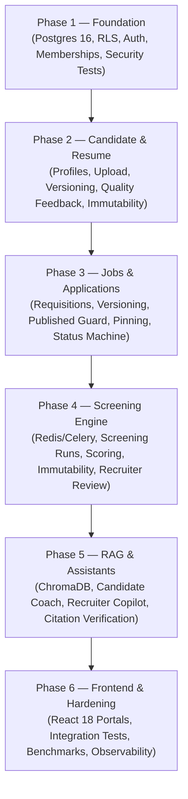

# TalentLens: Phased Engineering Implementation Roadmap

**Document Version**: 4.0  
**Target Architecture**: Modular Monolith with Staged Asynchronous Extensions  

---

## Version 4 Corrections

The following authoritative roadmap corrections have been implemented in Version 4:
1. **Logical Phase Dependency Reordering**: Corrected the architectural inversion. Candidate application submission and submitted resume pinning (Phase 3) now strictly precede recruiter bulk screening (Phase 4), ensuring screening snapshots evaluate existing, immutable applications.
2. **Infrastructure Justification Alignment**: Redis and Celery are introduced strictly in Phase 4 when asynchronous bulk screening batch jobs are built; ChromaDB is introduced in Phase 5 when RAG vector search is required. Phase 1 remains a lean stack consisting solely of **PostgreSQL 16, FastAPI, React 18, and Host Ollama**.
3. **Comprehensive Test Matrix Specification**: Added formal test specifications across all six required domains: Tenant Isolation, Resume Ownership, Application Integrity, Screening Integrity, AI Safety, and Audit Integrity.
4. **Hardware-Calibrated Local AI Staging**: Calibrated local model concurrency for Apple M2 (8GB RAM) running macOS. Documented model setup commands: `ollama pull nomic-embed-text`, `ollama pull qwen3:4b`, and `ollama pull llama3.2:1b`.
5. **Verified Frontend Dependencies**: Confirmed preservation of React 18 (`^18.3.1`), Vite (`^5.4.10`), and Tailwind CSS (`^4.3.2`) from `frontend/react-ts/package.json`.

---

## 1. Migration Strategy & Code Salvage Plan

```
┌────────────────────────────────────────────────────────────────────────┐
│                        CODE MIGRATION STRATEGY                         │
├───────────────────────┬────────────────────────┬───────────────────────┤
│   EXISTING ARTIFACT   │    DISPOSITION PATH    │     TARGET MODULE     │
├───────────────────────┼────────────────────────┼───────────────────────┤
│ candidate_profiles/*. │ Ingest as initial seed │ Database migrations   │
│ json                  │ data via Alembic       │ (scripts/seed_data.py)│
├───────────────────────┼────────────────────────┼───────────────────────┤
│ test/generate_mock.py │ Refactor into fixture  │ tests/fixtures/       │
│                       │ factory                │ resume_factory.py     │
├───────────────────────┼────────────────────────┼───────────────────────┤
│ Local Ollama          │ Retain local execution;│ app/infrastructure/   │
│ inference patterns    │ wrap in provider class │ ai/ollama_provider.py │
├───────────────────────┼────────────────────────┼───────────────────────┤
│ Prompt structures in  │ Extract into validated │ app/infrastructure/   │
│ batch_matcher.py      │ Pydantic prompts       │ ai/prompts.py         │
├───────────────────────┼────────────────────────┼───────────────────────┤
│ build_resume_index.py │ DISCARD ENTIRELY       │ app/infrastructure/   │
│ (shutil.rmtree wipe)  │ (Dangerous data wipe)  │ ai/vector_store.py    │
├───────────────────────┼────────────────────────┼───────────────────────┤
│ _heuristic_rank_      │ DISCARD ENTIRELY       │ app/domains/screening/│
│ candidates() (N * 20) │ (Flawed heuristic)     │ scoring_engine.py     │
├───────────────────────┼────────────────────────┼───────────────────────┤
│ main.py (Monolithic   │ DISCARD & REBUILD      │ app/main.py +         │
│ sync /match endpoint) │ as async domain routes │ app/domains/*/routes  │
├───────────────────────┼────────────────────────┼───────────────────────┤
│ React App.tsx         │ Refactor into modular  │ frontend/src/features/│
│ (Monolithic component)│ pages & components     │ (recruiter & candidate│
└───────────────────────┴────────────────────────┴───────────────────────┘
```

---

## 2. Reordered Phased Implementation Sequence



---

### Phase 1 — Foundation & Security Infrastructure
**Objective**: Establish a secure relational persistence layer with verified multi-tenant isolation, organization memberships, transaction-local context, and test suites.

- [ ] **Lean Infrastructure Boot (`docker-compose.dev.yml`)**:
  - PostgreSQL 16 with UUID and crypto extensions.
  - FastAPI Modular Monolith running locally or in a lean container.
  - React 18 + TypeScript + Vite frontend (`frontend/react-ts`).
  - Local filesystem storage adapter (`./data/uploads`) conforming to `StorageService` protocol.
  - *(Redis, Celery, MinIO, and ChromaDB are deferred to later phases).*
- [ ] **Host-to-Container AI Networking Setup**:
  - Configure `OLLAMA_BASE_URL` with `http://host.docker.internal:11434` for macOS/Windows.
  - Run host setup commands:
    ```bash
    ollama pull qwen3:4b
    ollama pull llama3.2:1b
    ollama pull nomic-embed-text
    ```
- [ ] **Decoupled Identity & Database Schema**:
  - Implement full schema from `DATABASE_SCHEMA.md` using SQLAlchemy 2.0 (async engine).
  - Create `organization_memberships` (Many-to-Many between `users` and `organizations`).
  - Create `talentlens_app` database role (`NOBYPASSRLS`, non-superuser).
  - Create `talentlens_admin` schema owner for migrations and security-definer functions.
  - Apply `FORCE ROW LEVEL SECURITY` with `AS PERMISSIVE` policies across all tables.
  - Implement parameterized transaction-scoped tenant injection (`scoped_tenant_session`) using `set_config('app.current_user_id', :uid, true)` and `set_config('app.current_org_id', :oid, true)`.
- [ ] **Initial Alembic Migrations & Seed Data**:
  - Apply initial migration creating all tables, indexes, triggers, and RLS policies.
  - Seed script importing legacy mock profiles (`cand_001.json` through `cand_006.json`) as candidates.
- [ ] **Auth & Membership API Endpoints**:
  - `POST /api/v1/auth/register`, `POST /api/v1/auth/login`, `POST /api/v1/auth/switch-context`, `GET /api/v1/auth/me`.
  - Organization management: `POST /api/v1/organizations`, `GET /api/v1/organizations/my-memberships`.

**Phase 1 Exit Criteria**:
1. Minimal stack boots cleanly in $< 10$ seconds.
2. Database migrations apply cleanly via Alembic.
3. Automated test suite proves `talentlens_app` cannot cross tenant boundaries without setting `app.current_org_id`.
4. Automated test proves `set_config(..., true)` resets across connection pool checkouts.
5. FastAPI backend communicates successfully with host Ollama.

---

### Phase 2 — Candidate & Resume Domain
**Objective**: Build candidate profile management, multi-version resume upload with magic-byte validation, text extraction, and objective document feedback.

- [ ] **Candidate Profile Endpoints**:
  - `GET /api/v1/candidate/profile`, `PUT /api/v1/candidate/profile`.
- [ ] **Resume Upload & Versioning**:
  - `POST /api/v1/candidate/resumes/upload` with binary signature validation (`%PDF-`, `PK\x03\x04`).
  - Version numbering (`version_number = max + 1`) leaving prior versions intact.
  - Non-destructive resume storage using `LocalStorageService`.
- [ ] **Deterministic Text & Entity Extraction**:
  - Two-pass extraction: `pdfplumber` + regex for links/dates + `qwen3:4b` JSON mode.
  - Store parsed structure in `parsed_profile`.
- [ ] **Objective Resume Quality Feedback**:
  - Compute $S_{quality}$ (structure, completeness, STAR impact statements) as document feedback only.
- [ ] **Resume Immutability Protection**:
  - Enforce database trigger `trg_protect_submitted_resumes` preventing mutation once submitted.

**Phase 2 Exit Criteria**: Candidates can upload multiple resume versions; quality feedback is generated; unsubmitted resumes are editable; submitted resumes are locked.

---

### Phase 3 — Jobs & Applications Domain
**Objective**: Implement requisition management, job versioning, published-job validation, candidate application submission, and submitted resume pinning.

- [ ] **Job Requisition Management**:
  - `POST /api/v1/recruiter/jobs`, `GET /api/v1/recruiter/jobs`, `PUT /api/v1/recruiter/jobs/{id}`.
  - Enforce job immutability of `organization_id` and track `version_number`.
  - Validate scoring weights sum to 1.0 (`chk_job_weights_sum`).
- [ ] **Candidate Job Discovery & Application Submission**:
  - `GET /api/v1/jobs` (filtered to `status = 'PUBLISHED'`).
  - `POST /api/v1/candidate/jobs/{id}/apply` with idempotency support via `idempotency_keys`.
  - Database trigger `trg_validate_job_application_submission` asserting job is `PUBLISHED`.
  - Composite foreign key enforcing that `submitted_resume_id` belongs to the applying candidate.
- [ ] **Application Status Lifecycle**:
  - `GET /api/v1/recruiter/jobs/{id}/applications`.
  - `PUT /api/v1/recruiter/applications/{id}/status` enforcing state machine transitions.
  - `rejection_reason` kept strictly confidential to recruiters.

**Phase 3 Exit Criteria**: Candidates apply to published jobs with pinned resume versions; cross-candidate resume submission is rejected by composite FK; recruiters view submitted resumes only.

---

### Phase 4 — Screening Engine & Reproducible Snapshots
**Objective**: Introduce asynchronous processing (Redis + Celery) to execute bulk candidate screening, evidence-based scoring, and immutable snapshotting.

- [ ] **Asynchronous Processing Fleet**:
  - Introduce Redis 7 and Celery worker fleet.
  - Implement task `execute_bulk_screening(screening_run_id, job_id)`.
- [ ] **Evidence-Based Scoring Engine**:
  - Three-valued evidence ontology (Demonstrated, Explicitly Absent, Unestablished).
  - Calculate Evidence Coverage ($C_{evidence}$) and Uncertainty ($U$). Flag `INSUFFICIENT_EVIDENCE` if $C_{evidence} < 0.30$.
  - Calendar-month experience deduplication.
  - Report semantic similarity strictly as an informational metric.
- [ ] **Screening Snapshot Immutability**:
  - Persist frozen metadata: `job_version`, `model_identifier`, `prompt_version`, `taxonomy_version`, `resume_content_hash`.
  - Enforce database trigger `trg_protect_screening_snapshots` preventing post-completion mutation.
- [ ] **Recruiter Review Endpoints**:
  - `POST /api/v1/recruiter/jobs/{id}/screenings`, `GET /api/v1/recruiter/screenings/{id}/results`.

**Phase 4 Exit Criteria**: Bulk screening evaluates 20 applicants; completed snapshots are immutable; transparent scores and verified citations are stored.

---

### Phase 5 — RAG & Conversational Assistants
**Objective**: Introduce ChromaDB vector storage for application-scoped recruiter copilot and private candidate career coach with prompt injection defenses.

- [ ] **ChromaDB Vector Repository**:
  - Spin up ChromaDB container.
  - Generate embeddings using local `nomic-embed-text`.
- [ ] **Candidate Career Coach**:
  - `POST /api/v1/candidate/assistant/chat` scoped strictly to candidate's own resumes.
- [ ] **Recruiter Requisition Copilot**:
  - `POST /api/v1/recruiter/jobs/{id}/assistant/chat`.
  - Dynamically query PostgreSQL for authorized `submitted_resume_id`s, then pass whitelist filter to ChromaDB.
- [ ] **Prompt Injection & Sandboxing**:
  - Wrap resume text in untrusted delimiters.
  - Grounding check verifying LLM citations against source text.
  - Database trigger preventing clients from inserting `ASSISTANT` sender roles.

**Phase 5 Exit Criteria**: Recruiter copilot answers questions grounded in authorized applications only; prompt injection attempts are sandboxed; candidate chat remains private.

---

### Phase 6 — Frontend & Production Hardening
**Objective**: Build full React 18 frontend, comprehensive test suite, performance benchmarks, and deployment artifacts.

- [ ] **React 18 + TypeScript Full-Stack Frontend**:
  - Candidate portal: Profile editor, resume manager, application tracker, career coach UI.
  - Recruiter portal: Requisition builder, candidate pipeline, comparison matrix, copilot drawer.
  - Preserve React 18 (`^18.3.1`) and Vite (`^5.4.10`) dependencies.
- [ ] **End-to-End Test Suite**:
  - Execute full test matrix across Tenant Isolation, Resume Ownership, Application Integrity, Screening Integrity, AI Safety, and Audit Integrity.
- [ ] **Observability & Deployment**:
  - Prometheus metrics instrumentation.
  - Multi-stage production Dockerfiles.

**Phase 6 Exit Criteria**: All test suites pass; 85%+ coverage on security and scoring modules; local container deployment boots cleanly.

---

## 3. Formal Testing & Validation Matrix

```
┌────────────────────────────────────────────────────────────────────────┐
│                        FORMAL TEST SPECIFICATION                       │
├──────────────────────┬─────────────────────────────────────────────────┤
│ 1. Tenant Isolation  │ • Org A user cannot read Org B jobs.            │
│                      │ • Multi-org user sees active org data only.     │
│                      │ • set_config(..., true) cleanses on commit.     │
│                      │ • Spoofed org ID in request body fails closed.  │
├──────────────────────┼─────────────────────────────────────────────────┤
│ 2. Resume Ownership  │ • Candidate cannot read another's resumes.      │
│                      │ • Recruiter cannot read unsubmitted resumes.    │
│                      │ • Trigger blocks mutation of submitted resume.  │
│                      │ • New upload increments version, leaves old.    │
├──────────────────────┼─────────────────────────────────────────────────┤
│ 3. App Integrity     │ • Candidate cannot apply to draft/closed jobs.  │
│                      │ • Composite FK blocks submitting foreign resume.│
│                      │ • Trigger locks candidate_id and job_id.        │
│                      │ • Invalid status transition raises exception.   │
├──────────────────────┼─────────────────────────────────────────────────┤
│ 4. Screening Audit   │ • Composite FK links run, app, and resume.      │
│                      │ • Trigger blocks update/delete on completed run.│
│                      │ • Idempotency key caches duplicate trigger.     │
│                      │ • Concurrent screening requests lock row safely.│
├──────────────────────┼─────────────────────────────────────────────────┤
│ 5. AI Safety & RAG   │ • Prompt injection in resume ignored by model.  │
│                      │ • Unestablished skills do not zero score.       │
│                      │ • Recruiter RAG restricts to authorized apps.   │
│                      │ • Trigger blocks client-inserted ASSISTANT msg. │
├──────────────────────┼─────────────────────────────────────────────────┤
│ 6. Audit Integrity   │ • Forged user_id or org_id in audit fails.      │
│                      │ • UPDATE and DELETE revoked on audit_logs.      │
└──────────────────────┴─────────────────────────────────────────────────┘
```
