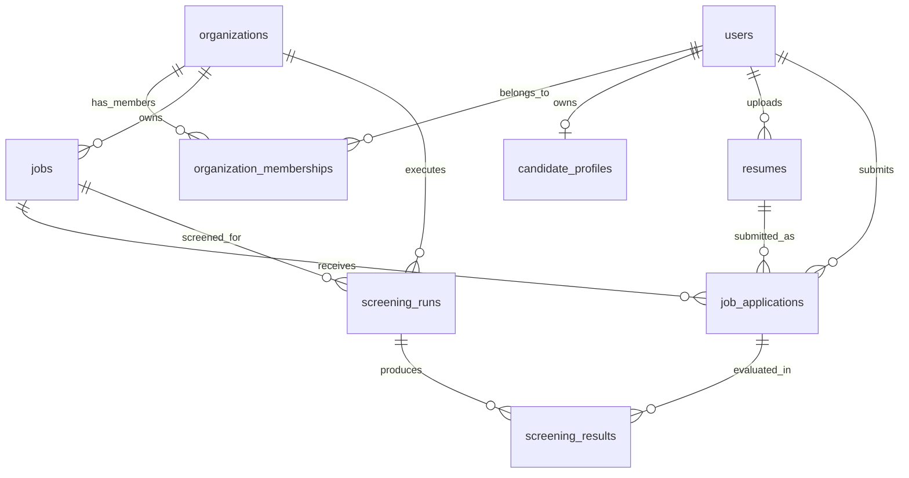

# TalentLens MVP: Database Schema & Multi-Tenancy Architecture Plan

**Document Version**: 1.0  
**Status**: Approved MVP Engineering Plan  
**Target Platform**: TalentLens MVP — Multi-Tenant Recruitment Platform  
**Target Engine**: PostgreSQL 16+ (Local Postgres.app on macOS port 5432)  

---

## 1. Multi-Tenancy Conceptual Model & Ownership Rules

TalentLens MVP enforces strict multi-tenant boundaries from day one using a relational ownership architecture:



### Core Ownership Invariants:
1. **Global Identities**: A `user` is an independent global identity on the platform. A single user can be a candidate applying to jobs and simultaneously hold recruiter memberships in one or more organizations.
2. **Candidate Data Privacy**: Candidates own their `candidate_profiles` and `resumes`. A recruiter cannot view a candidate's profile or alternative resumes unless the candidate explicitly submits an application to a job owned by the recruiter's active organization.
3. **Application Version Pinning**: When a candidate applies to a job, the application permanently references `submitted_resume_id`. Even if the candidate uploads newer resumes later, the recruiter only ever sees the exact submitted version.
4. **Tenant-Scoped Requisitions**: `jobs` are strictly owned by an `organization_id`. Recruiters can only manage and view jobs belonging to organizations where they have active membership.
5. **No Global Candidate Discovery**: Recruiters cannot browse the global candidate database; they only see candidates who have submitted applications to their organization's jobs.

---

## 2. Practical Multi-Tenancy Enforcement for MVP

For the MVP, multi-tenancy is enforced through **strict application-layer authorization guards and composite database constraints**, combined with clean tenant-scoped queries:

### 2.1 The Active Organization Pattern
- When a recruiter logs in or switches organizations, their session/JWT carries `active_org_id`.
- The FastAPI dependency `get_active_recruiter_membership` verifies:
  1. `user_id` matches the authenticated token.
  2. The user has an active record in `organization_memberships` for `active_org_id`.
  3. The user's role has permission for the requested action (e.g. `OWNER`, `ADMIN`, `RECRUITER`).
- All repository queries for recruiter data inject an explicit constraint:
  `WHERE organization_id = :active_org_id`.

### 2.2 Path to Future PostgreSQL RLS
The MVP schema is designed to be 100% compatible with PostgreSQL Row-Level Security (RLS). All tenant tables contain `organization_id`, and all candidate tables contain `user_id` or `candidate_id`. In Phase 6, RLS policies can be activated via Alembic migration without changing table structures.

---

## 3. PostgreSQL Schema DDL Specification

```sql
-- ============================================================================
-- EXTENSIONS & CUSTOM ENUMS
-- ============================================================================
CREATE EXTENSION IF NOT EXISTS "uuid-ossp";

CREATE TYPE system_role AS ENUM (
    'PLATFORM_USER',
    'PLATFORM_ADMIN'
);

CREATE TYPE organization_role AS ENUM (
    'OWNER',
    'ADMIN',
    'RECRUITER',
    'VIEWER'
);

CREATE TYPE job_status AS ENUM (
    'DRAFT',
    'PUBLISHED',
    'CLOSED'
);

CREATE TYPE application_status AS ENUM (
    'SUBMITTED',
    'UNDER_REVIEW',
    'SHORTLISTED',
    'INTERVIEWING',
    'REJECTED',
    'HIRED'
);

CREATE TYPE screening_status AS ENUM (
    'PENDING',
    'COMPLETED',
    'FAILED'
);

-- ============================================================================
-- 1. USERS & ORGANIZATIONS (GLOBAL IDENTITIES & TENANTS)
-- ============================================================================
CREATE TABLE users (
    id UUID PRIMARY KEY DEFAULT gen_random_uuid(),
    email VARCHAR(255) UNIQUE NOT NULL,
    password_hash VARCHAR(255) NOT NULL,
    full_name VARCHAR(255) NOT NULL,
    system_role system_role NOT NULL DEFAULT 'PLATFORM_USER',
    is_active BOOLEAN NOT NULL DEFAULT TRUE,
    created_at TIMESTAMPTZ NOT NULL DEFAULT CURRENT_TIMESTAMP,
    updated_at TIMESTAMPTZ NOT NULL DEFAULT CURRENT_TIMESTAMP
);

CREATE INDEX idx_users_email ON users(email);

CREATE TABLE organizations (
    id UUID PRIMARY KEY DEFAULT gen_random_uuid(),
    name VARCHAR(255) NOT NULL,
    slug VARCHAR(64) UNIQUE NOT NULL,
    is_active BOOLEAN NOT NULL DEFAULT TRUE,
    created_at TIMESTAMPTZ NOT NULL DEFAULT CURRENT_TIMESTAMP,
    updated_at TIMESTAMPTZ NOT NULL DEFAULT CURRENT_TIMESTAMP
);

CREATE TABLE organization_memberships (
    id UUID PRIMARY KEY DEFAULT gen_random_uuid(),
    organization_id UUID NOT NULL REFERENCES organizations(id) ON DELETE CASCADE,
    user_id UUID NOT NULL REFERENCES users(id) ON DELETE CASCADE,
    role organization_role NOT NULL DEFAULT 'RECRUITER',
    is_active BOOLEAN NOT NULL DEFAULT TRUE,
    created_at TIMESTAMPTZ NOT NULL DEFAULT CURRENT_TIMESTAMP,
    CONSTRAINT uq_org_user UNIQUE(organization_id, user_id)
);

CREATE INDEX idx_memberships_user ON organization_memberships(user_id, is_active);
CREATE INDEX idx_memberships_org ON organization_memberships(organization_id, is_active);

-- ============================================================================
-- 2. CANDIDATES & RESUMES
-- ============================================================================
CREATE TABLE candidate_profiles (
    id UUID PRIMARY KEY DEFAULT gen_random_uuid(),
    user_id UUID UNIQUE NOT NULL REFERENCES users(id) ON DELETE CASCADE,
    headline VARCHAR(255),
    summary TEXT,
    phone VARCHAR(32),
    location VARCHAR(128),
    skills JSONB NOT NULL DEFAULT '[]'::JSONB,
    total_years_experience NUMERIC(4, 1) DEFAULT 0.0,
    created_at TIMESTAMPTZ NOT NULL DEFAULT CURRENT_TIMESTAMP,
    updated_at TIMESTAMPTZ NOT NULL DEFAULT CURRENT_TIMESTAMP
);

CREATE TABLE resumes (
    id UUID PRIMARY KEY DEFAULT gen_random_uuid(),
    candidate_id UUID NOT NULL REFERENCES users(id) ON DELETE CASCADE,
    version_number INTEGER NOT NULL DEFAULT 1,
    title VARCHAR(128) NOT NULL DEFAULT 'Default Resume',
    file_path VARCHAR(512) NOT NULL, -- Local filesystem path: ./data/resumes/...
    file_name VARCHAR(255) NOT NULL,
    file_size_bytes BIGINT NOT NULL,
    file_hash VARCHAR(64) NOT NULL, -- SHA-256
    parsed_data JSONB NOT NULL DEFAULT '{}'::JSONB, -- Extracted skills, experience, summary
    created_at TIMESTAMPTZ NOT NULL DEFAULT CURRENT_TIMESTAMP,
    CONSTRAINT uq_candidate_resume_version UNIQUE(candidate_id, version_number),
    CONSTRAINT uq_resume_candidate UNIQUE(id, candidate_id) -- Enables composite foreign key
);

CREATE INDEX idx_resumes_candidate ON resumes(candidate_id);

-- ============================================================================
-- 3. JOBS (ORGANIZATION-SCOPED)
-- ============================================================================
CREATE TABLE jobs (
    id UUID PRIMARY KEY DEFAULT gen_random_uuid(),
    organization_id UUID NOT NULL REFERENCES organizations(id) ON DELETE RESTRICT,
    created_by_user_id UUID NOT NULL REFERENCES users(id),
    title VARCHAR(255) NOT NULL,
    department VARCHAR(128),
    location VARCHAR(128),
    status job_status NOT NULL DEFAULT 'DRAFT',
    description TEXT NOT NULL,
    
    -- Structured Requirements
    required_skills JSONB NOT NULL DEFAULT '[]'::JSONB, -- e.g. ["React", "TypeScript", "Node.js"]
    preferred_skills JSONB NOT NULL DEFAULT '[]'::JSONB, -- e.g. ["Docker", "AWS"]
    minimum_years_experience NUMERIC(4, 1) NOT NULL DEFAULT 0.0,
    
    created_at TIMESTAMPTZ NOT NULL DEFAULT CURRENT_TIMESTAMP,
    updated_at TIMESTAMPTZ NOT NULL DEFAULT CURRENT_TIMESTAMP,
    CONSTRAINT uq_job_org UNIQUE(id, organization_id)
);

CREATE INDEX idx_jobs_org_status ON jobs(organization_id, status);

-- ============================================================================
-- 4. APPLICATIONS (CANDIDATE-JOB JUNCTION)
-- ============================================================================
CREATE TABLE job_applications (
    id UUID PRIMARY KEY DEFAULT gen_random_uuid(),
    job_id UUID NOT NULL,
    organization_id UUID NOT NULL,
    candidate_id UUID NOT NULL REFERENCES users(id) ON DELETE CASCADE,
    submitted_resume_id UUID NOT NULL,
    status application_status NOT NULL DEFAULT 'SUBMITTED',
    rejection_reason TEXT, -- Confidential to recruiters; omitted from candidate API
    applied_at TIMESTAMPTZ NOT NULL DEFAULT CURRENT_TIMESTAMP,
    updated_at TIMESTAMPTZ NOT NULL DEFAULT CURRENT_TIMESTAMP,
    CONSTRAINT uq_job_candidate UNIQUE(job_id, candidate_id),
    -- Verify job belongs to organization
    CONSTRAINT fk_app_job_org FOREIGN KEY (job_id, organization_id)
        REFERENCES jobs(id, organization_id) ON DELETE RESTRICT,
    -- Anti-IDOR: Candidate can ONLY submit their own resume
    CONSTRAINT fk_app_candidate_resume FOREIGN KEY (submitted_resume_id, candidate_id)
        REFERENCES resumes(id, candidate_id) ON DELETE RESTRICT,
    CONSTRAINT uq_app_composite UNIQUE(id, job_id, organization_id, candidate_id, submitted_resume_id)
);

CREATE INDEX idx_applications_job ON job_applications(job_id, status);
CREATE INDEX idx_applications_candidate ON job_applications(candidate_id);
CREATE INDEX idx_applications_org ON job_applications(organization_id);

-- ============================================================================
-- 5. AI SCREENING (REQUISITION-SCOPED SNAPSHOTS)
-- ============================================================================
CREATE TABLE screening_runs (
    id UUID PRIMARY KEY DEFAULT gen_random_uuid(),
    job_id UUID NOT NULL,
    organization_id UUID NOT NULL,
    triggered_by_user_id UUID NOT NULL REFERENCES users(id),
    status screening_status NOT NULL DEFAULT 'PENDING',
    model_identifier VARCHAR(128) NOT NULL DEFAULT 'qwen3:4b',
    total_screened INTEGER NOT NULL DEFAULT 0,
    created_at TIMESTAMPTZ NOT NULL DEFAULT CURRENT_TIMESTAMP,
    completed_at TIMESTAMPTZ,
    CONSTRAINT fk_run_job_org FOREIGN KEY (job_id, organization_id)
        REFERENCES jobs(id, organization_id) ON DELETE RESTRICT,
    CONSTRAINT uq_run_org_job UNIQUE(id, organization_id, job_id)
);

CREATE INDEX idx_screening_runs_job ON screening_runs(job_id, created_at DESC);

CREATE TABLE screening_results (
    id UUID PRIMARY KEY DEFAULT gen_random_uuid(),
    screening_run_id UUID NOT NULL,
    job_id UUID NOT NULL,
    organization_id UUID NOT NULL,
    job_application_id UUID NOT NULL,
    candidate_id UUID NOT NULL REFERENCES users(id) ON DELETE CASCADE,
    evaluated_resume_id UUID NOT NULL,
    
    -- Deterministic Scores (0.0 to 100.0)
    final_score NUMERIC(5, 2) NOT NULL,
    required_skills_score NUMERIC(5, 2) NOT NULL,
    preferred_skills_score NUMERIC(5, 2) NOT NULL,
    experience_score NUMERIC(5, 2) NOT NULL,
    
    -- Evidence Details
    matched_skills JSONB NOT NULL DEFAULT '[]'::JSONB,
    missing_skills JSONB NOT NULL DEFAULT '[]'::JSONB,
    experience_assessment VARCHAR(64) NOT NULL, -- e.g. "MEETS_REQUIREMENT (6.5 / 4.0 Years)"
    reasoning TEXT NOT NULL,
    
    created_at TIMESTAMPTZ NOT NULL DEFAULT CURRENT_TIMESTAMP,
    CONSTRAINT uq_run_application UNIQUE(screening_run_id, job_application_id),
    CONSTRAINT fk_result_run FOREIGN KEY (screening_run_id, organization_id, job_id)
        REFERENCES screening_runs(id, organization_id, job_id) ON DELETE CASCADE,
    CONSTRAINT fk_result_app FOREIGN KEY (job_application_id, job_id, organization_id, candidate_id, evaluated_resume_id)
        REFERENCES job_applications(id, job_id, organization_id, candidate_id, submitted_resume_id) ON DELETE RESTRICT
);

CREATE INDEX idx_screening_results_score ON screening_results(screening_run_id, final_score DESC);
```

---

## 4. Connection Setup & Migration Strategy

### 4.1 Database Configuration (`.env`)
The MVP uses direct connection to the local Postgres.app instance on macOS:
```ini
DATABASE_URL=postgresql+asyncpg://saranshop@localhost:5432/talentlens_mvp
DATABASE_SYNC_URL=postgresql://saranshop@localhost:5432/talentlens_mvp
```
*(No Docker required; connects seamlessly to Postgres.app running on port 5432).*

### 4.2 Alembic Setup
- Alembic will manage migrations:
  `alembic revision --autogenerate -m "create_mvp_tables"`
  `alembic upgrade head`
- Async SQLAlchemy 2.0 session maker:
  ```python
  engine = create_async_engine(settings.DATABASE_URL, echo=False)
  AsyncSessionLocal = async_sessionmaker(
      engine, expire_on_commit=False, class_=AsyncSession
  )
```

---

## 5. Seed Data Plan

A seed script (`backend/scripts/seed_mvp_data.py`) will automatically populate the local database:
1. **Create Default Organizations**:
   - Organization 1: `Acme Cloud Corp` (`acme-cloud`)
   - Organization 2: `TalentLens Labs` (`talentlens-labs`)
2. **Create Test Recruiter & Memberships**:
   - `recruiter@acme.com` (Member of Acme Cloud Corp as `OWNER`, and Member of TalentLens Labs as `RECRUITER`)
3. **Ingest Existing Sample JD**:
   - Ingest `backend/data/jds/jd.json` as a published job under Acme Cloud Corp ("Full Stack Developer", 4 years YoE, React, Node.js, TypeScript, PostgreSQL, Docker, AWS).
4. **Ingest 6 Mock Candidates & Resumes**:
   - Create user accounts and candidate profiles from `cand_001.json` through `cand_006.json`.
   - Link their corresponding PDFs from `backend/data/resumes/cand_001.pdf` through `cand_006.pdf`.
   - Submit applications for 4 candidates to the Acme job to provide an immediate testable applicant pool for screening.
