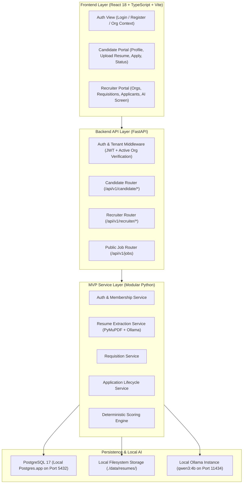

# TalentLens MVP: End-to-End Implementation Plan

**Document Version**: 1.0  
**Status**: Ready for Implementation  
**Target Milestone**: Multi-Tenant MVP Delivery  
**Local Development Hardware**: Apple M2 (8GB RAM), macOS  

---

## 1. Minimal Implementation Architecture

The TalentLens MVP delivers complete candidate and recruiter workflows with multi-tenant isolation from day one, without the operational overhead of microservices, distributed queues, or vector databases.



### Architectural Decisions for MVP:
1. **Direct Local PostgreSQL Connection**: Uses the existing Postgres.app running on `localhost:5432` with an async SQLAlchemy 2.0 driver. Docker is not required for MVP development.
2. **Local Host Ollama Execution**: Uses the pre-installed local Ollama instance on `localhost:11434` with `qwen3:4b` for structured entity extraction and reasoning synthesis. Zero paid cloud API keys.
3. **Local Filesystem Document Storage**: Uploaded resume PDFs are saved to `./backend/data/resumes/{candidate_id}/{resume_id}.pdf` with SHA-256 integrity verification. S3/MinIO is deferred.
4. **Deterministic In-Process Scoring**: Evaluates candidate fit in pure Python using exact canonical skill matching and experience alignment. Vector search (ChromaDB) and distributed queues (Redis/Celery) are deferred.

---

## 2. Step-by-Step Implementation Milestones

---

### Milestone 1: Foundation, Database & Authentication
**Goal**: Establish the PostgreSQL database schema with Alembic migrations, password hashing, JWT generation, user registration, and login.

- **Files to Create / Modify**:
  - `backend/app/core/config.py`: Pydantic settings loading `DATABASE_URL`, `JWT_SECRET`, etc.
  - `backend/app/core/database.py`: SQLAlchemy async engine and session factory.
  - `backend/app/core/security.py`: Password hashing (`passlib[bcrypt]`) and JWT token utilities (`pyjwt`).
  - `backend/app/models/base.py`: Declarative base with timestamp mixins.
  - `backend/app/models/user.py`: `User` SQLAlchemy model.
  - `backend/app/api/auth.py`: `/auth/register`, `/auth/login`, and `/auth/me` routes.
  - `backend/alembic/`: Alembic environment configuration and initial migration.
- **Dependencies**: `sqlalchemy`, `asyncpg`, `alembic`, `pyjwt`, `passlib[bcrypt]`, `pydantic-settings`.
- **API Endpoints**:
  - `POST /api/v1/auth/register`
  - `POST /api/v1/auth/login`
  - `GET /api/v1/auth/me`
- **Database Changes**: Tables `users`.
- **Acceptance Criteria**:
  - Candidate and Recruiter can register with email and password.
  - Login returns a valid JWT containing `user_id` and `email`.
  - Passwords are encrypted with bcrypt; plaintext passwords are never stored.
- **Test Command**: `pytest backend/tests/test_auth.py`

---

### Milestone 2: Organization & Membership Management
**Goal**: Enable recruiters to create organizations, switch active organization contexts, and invite members with roles.

- **Files to Create / Modify**:
  - `backend/app/models/organization.py`: `Organization` and `OrganizationMembership` models.
  - `backend/app/api/recruiter_org.py`: Organization CRUD, member management, and context switching.
  - `backend/app/api/deps.py`: `get_active_recruiter_context` dependency guard verifying active membership.
- **API Endpoints**:
  - `POST /api/v1/recruiter/organizations`: Create organization (creator becomes `OWNER`).
  - `GET /api/v1/recruiter/organizations`: List organizations the user belongs to.
  - `POST /api/v1/auth/switch-organization`: Select active organization; returns updated JWT.
  - `POST /api/v1/recruiter/organizations/{id}/members`: Add/invite member by email with role.
  - `GET /api/v1/recruiter/organizations/{id}/members`: List active members.
- **Database Changes**: Tables `organizations`, `organization_memberships`.
- **Acceptance Criteria**:
  - Recruiter can create multiple organizations.
  - Switching context issues a JWT carrying `active_org_id` and verified `org_role`.
  - Requests with forged or unassigned `active_org_id` fail with HTTP 403.
- **Test Command**: `pytest backend/tests/test_organizations.py`

---

### Milestone 3: Candidate Resume Upload & PDF Parsing
**Goal**: Allow candidates to upload PDF resumes, extract clean text via PyMuPDF, and parse structured skills and experience via local Ollama (`qwen3:4b`).

- **Files to Create / Modify**:
  - `backend/app/models/resume.py`: `CandidateProfile` and `Resume` models.
  - `backend/app/services/pdf_extractor.py`: PyMuPDF (`fitz`) text extraction stream.
  - `backend/app/services/llm_parser.py`: Ollama client sending structured JSON extraction prompt to `qwen3:4b`.
  - `backend/app/api/candidate_resume.py`: Resume upload and profile management routes.
- **Dependencies**: `pymupdf`, `httpx` (or `ollama`), `python-multipart`.
- **API Endpoints**:
  - `GET /api/v1/candidate/profile`, `PUT /api/v1/candidate/profile`
  - `POST /api/v1/candidate/resumes/upload`: Multipart PDF upload, parsing, and JSON storage.
  - `GET /api/v1/candidate/resumes`: List uploaded resumes.
  - `GET /api/v1/candidate/resumes/{id}`: View parsed data and extracted skills.
- **Database Changes**: Tables `candidate_profiles`, `resumes`.
- **Acceptance Criteria**:
  - Uploading a PDF extracts text accurately without layout crashes.
  - Local Ollama extracts `candidate_name`, `years_of_experience`, and `top_skills` as strict JSON.
  - Extracted data is saved to PostgreSQL and resume file is persisted locally.
- **Test Command**: `pytest backend/tests/test_resume_upload.py`

---

### Milestone 4: Requisition Management & Public Job Discovery
**Goal**: Allow recruiters to create and publish structured job openings for their organization, and allow candidates to browse published jobs.

- **Files to Create / Modify**:
  - `backend/app/models/job.py`: `Job` model with JSONB `required_skills` and `preferred_skills`.
  - `backend/app/api/recruiter_jobs.py`: Recruiter job CRUD and status toggles.
  - `backend/app/api/public_jobs.py`: Public published job listing.
- **API Endpoints**:
  - `POST /api/v1/recruiter/jobs`: Create job requisition under `active_org_id`.
  - `GET /api/v1/recruiter/jobs`: List organization's jobs.
  - `PUT /api/v1/recruiter/jobs/{id}`: Update job requirements or publish (`DRAFT` $\rightarrow$ `PUBLISHED` $\rightarrow$ `CLOSED`).
  - `GET /api/v1/jobs`: Public endpoint returning all `PUBLISHED` jobs across organizations.
  - `GET /api/v1/jobs/{id}`: Public endpoint returning specific job details.
- **Database Changes**: Table `jobs`.
- **Acceptance Criteria**:
  - Recruiter can create a job with structured skills (`["React", "Node.js"]`) and minimum YoE.
  - Draft jobs are visible only to the owning organization's recruiters.
  - Candidates can only view jobs in `PUBLISHED` status.
- **Test Command**: `pytest backend/tests/test_jobs.py`

---

### Milestone 5: Candidate Job Applications & Resume Pinning
**Goal**: Allow candidates to apply to published jobs with an immutable resume version, and allow recruiters to review applicants.

- **Files to Create / Modify**:
  - `backend/app/models/application.py`: `JobApplication` model.
  - `backend/app/api/candidate_applications.py`: Job application submission and tracking.
  - `backend/app/api/recruiter_applications.py`: Recruiter applicant review and status updates.
- **API Endpoints**:
  - `POST /api/v1/candidate/jobs/{id}/apply`: Submit application referencing candidate's `resume_id`.
  - `GET /api/v1/candidate/applications`: Candidate view of submitted applications and status.
  - `GET /api/v1/recruiter/jobs/{id}/applications`: Recruiter view of applicants for their job.
  - `GET /api/v1/recruiter/applications/{id}/resume`: Download submitted resume PDF.
  - `PUT /api/v1/recruiter/applications/{id}/status`: Advance candidate status (`UNDER_REVIEW`, `SHORTLISTED`, etc.).
- **Database Changes**: Table `job_applications`.
- **Acceptance Criteria**:
  - Candidate can only apply to `PUBLISHED` jobs.
  - Application strictly pins `submitted_resume_id`.
  - Recruiter cannot view candidate applications belonging to other organizations.
  - `rejection_reason` is never exposed in candidate responses.
- **Test Command**: `pytest backend/tests/test_applications.py`

---

### Milestone 6: AI Screening & Deterministic Scoring Engine
**Goal**: Implement transparent multi-factor candidate screening: canonical skill overlap, experience check, fit score computation, and Ollama reasoning synthesis.

- **Files to Create / Modify**:
  - `backend/app/models/screening.py`: `ScreeningRun` and `ScreeningResult` models.
  - `backend/app/services/scoring_engine.py`: Deterministic scoring logic:
    $$S_{fit} = 0.60 \cdot S_{req\_skills} + 0.15 \cdot S_{pref\_skills} + 0.25 \cdot S_{experience}$$
  - `backend/app/services/llm_explainer.py`: Prompts Ollama (`qwen3:4b`) to synthesize reasoning based on matched/missing evidence.
  - `backend/app/api/recruiter_screening.py`: Screening trigger and results endpoints.
- **API Endpoints**:
  - `POST /api/v1/recruiter/jobs/{id}/screen`: Execute screening over applicants; persists snapshot.
  - `GET /api/v1/recruiter/jobs/{id}/screening-results`: Fetch ranked applicants with transparent score breakdowns.
- **Database Changes**: Tables `screening_runs`, `screening_results`.
- **Acceptance Criteria**:
  - Exact tokenized skill matching (eliminates substring bugs).
  - Experience score calculates: $\min(100, \frac{\text{cand\_yoe}}{\text{req\_yoe}} \times 100)$.
  - Scores are transparent: shows matched skills, missing skills, experience status, and reasoning.
  - AI scores never automatically reject or modify application statuses.
- **Test Command**: `pytest backend/tests/test_screening.py`

---

### Milestone 7: Frontend Integration (Candidate & Recruiter Portals)
**Goal**: Replace the monolithic `App.tsx` with modular React components supporting authentication, candidate portal, recruiter portal, and screening dashboards.

- **Files to Create / Modify**:
  - `frontend/react-ts/src/context/AuthContext.tsx`: Manages JWT, active organization, and user role.
  - `frontend/react-ts/src/components/Navbar.tsx`: Header with organization context switcher and logout.
  - `frontend/react-ts/src/components/CandidatePortal.tsx`: Upload resume, browse jobs, apply, view applications.
  - `frontend/react-ts/src/components/RecruiterPortal.tsx`: Organization selector, job creation modal, applicant table.
  - `frontend/react-ts/src/components/ScreeningResultsView.tsx`: Ranked candidate cards showing score breakdown and evidence.
  - `frontend/react-ts/src/App.tsx`: Top-level router / tab switcher based on authenticated role.
- **Dependencies**: Uses existing React 18, Vite 5, Tailwind CSS v4. Optional: `lucide-react` for icons.
- **Acceptance Criteria**:
  - Users can register and switch between Candidate and Recruiter views.
  - Candidates can upload a PDF and see extracted skills.
  - Candidates can click "Apply" on a job.
  - Recruiters can click "Screen Applicants" and view ranked candidate cards with score breakdowns.

---

### Milestone 8: End-to-End Automated Testing & Seed Verification
**Goal**: Validate full end-to-end user journeys and verify multi-tenant isolation through automated pytest scripts.

- **Files to Create**:
  - `backend/scripts/seed_mvp_data.py`: Seeds Acme Cloud Corp, jobs, and 6 mock candidates.
  - `backend/tests/test_e2e_workflow.py`: Complete workflow test: Register $\rightarrow$ Create Org $\rightarrow$ Post Job $\rightarrow$ Upload Resume $\rightarrow$ Apply $\rightarrow$ Screen $\rightarrow$ View Results.
  - `backend/tests/test_tenant_isolation.py`: Negative security tests asserting Recruiter A cannot query Recruiter B's applications or screening snapshots.
- **Acceptance Criteria**:
  - All unit, integration, and tenant isolation tests pass with 0 failures.
  - Seed script successfully populates local PostgreSQL with testable data.
- **Test Command**: `pytest backend/tests/`

---

## 3. Local Development Run Guide

Once implemented, the MVP runs entirely on the local Mac host:

```bash
# 1. Start Backend (Terminal 1)
cd backend
source venv/bin/activate
uvicorn app.main:app --reload --port 8000

# 2. Start Frontend (Terminal 2)
cd frontend/react-ts
npm run dev
# Running on http://localhost:5173

# 3. Prerequisites Verified:
# - PostgreSQL running via Postgres.app on localhost:5432
# - Ollama running via native Mac app on localhost:11434 (qwen3:4b loaded)
```
